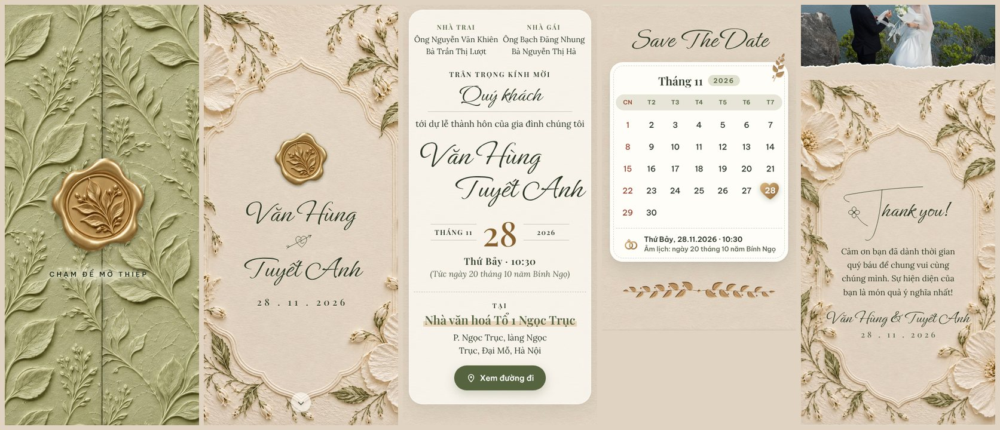

# Thiệp cưới online

Repo có **2 mẫu thiệp**, dùng chung file Google Sheets. Mẫu đỏ rượu dùng ảnh trong `assets/anh/` (đang là ảnh mẫu); mẫu xanh pastel dùng ảnh cưới thật trong `xanh-pastel/assets/anh/`:

| Mẫu | Link | Sửa nội dung ở |
|---|---|---|
| **Đỏ rượu** — phong bì sáp, polaroid, tim rơi | `/` (trang chính) | `js/config.js` |
| **Xanh pastel** — thiệp Văn Hùng & Tuyết Anh: giấy xanh xô thơm dập nổi lá cây, hai cánh mở, dấu sáp vàng | `/xanh-pastel/` | `xanh-pastel/js/config.js` |

Gửi khách link của mẫu bạn chọn (ví dụ `https://ten-ban.github.io/bokin-thiep-onl/xanh-pastel/?to=Ngọc%20Anh`).

---

## Mẫu đỏ rượu — phong bì sáp, polaroid

Thiệp cưới một trang cho điện thoại: phong bì “Nhấp để mở” với con dấu sáp, ảnh polaroid bay ra, tim rơi, lịch tháng cưới, đếm ngược, lễ cưới của **nhà trai / nhà gái** kèm **ngày âm lịch**, lịch trình, album ảnh, xác nhận tham dự, **sổ lưu bút có ký tên bằng tay**, mã QR mừng cưới và lời cảm ơn.

Chỉ là HTML + CSS + JavaScript thuần: **không cần cài đặt, không cần build**, đăng miễn phí lên GitHub Pages / Vercel / Netlify.


## Các phần của thiệp

1. **Phong bì** — “Nhấp để mở”, ảnh polaroid trượt vào phong bì, nắp mở ra, 2 ảnh bay lên, tim bắt đầu rơi, nhạc nền phát.
2. **Lịch tháng** — trên nền ảnh, ngày cưới đánh dấu bằng trái tim.
3. **Chữ lồng + đếm ngược** — ngày / giờ / phút / giây.
4. **Ảnh chính**, **lời mời** (“Quý vị & Gia đình” hoặc tên khách), ảnh **chú rể / cô dâu**, tên **bố mẹ hai bên**.
5. **Tab Nhà gái / Nhà trai** — mỗi nhà một danh sách lễ (Lễ Vu Quy, Lễ Thành Hôn, Tiệc Cưới…) với giờ, thứ, ngày dương, **ngày âm lịch tự tính**, địa điểm, nút *Xem bản đồ*.
6. **Lịch trình** trong ngày và **dress code**.
7. **Album hình cưới** — chạm để xem ảnh lớn, vuốt qua lại.
8. **Xác nhận tham dự** — tên, khách nhà trai/nhà gái, có đến không, số người.
9. **Sổ lưu bút** — khách **ký tên bằng ngón tay** và gửi lời chúc; lời chúc hiện ngay trên thiệp.
10. **Gửi quà mừng cưới** — mã QR của hai nhà, nút sao chép số tài khoản.
11. **Đếm ngược trong trái tim** và **lời cảm ơn**.

## Sửa thông tin

Mọi nội dung nằm trong **`js/config.js`**: tên, ngày giờ từng lễ, địa chỉ, link bản đồ, bố mẹ hai bên, lịch trình, bảng màu dress code, tài khoản mừng cưới…
Thứ trong tuần và ngày âm lịch được tính tự động (thuật toán âm lịch Việt Nam của Hồ Ngọc Đức, múi giờ +7).

Nhớ sửa thêm `<title>` và các thẻ `og:` trong `index.html` — đó là chữ hiện ra khi gửi link qua Zalo/Messenger.

### Thay ảnh

Thư mục `assets/anh/` đang chứa **ảnh mẫu** (khung có ghi “ẢNH MẪU · thay file …”). Chép ảnh cưới của bạn đè lên **đúng tên file**:

| File | Dùng cho | Tỉ lệ nên dùng |
|---|---|---|
| `bia.jpg`, `bia-2.jpg` | ảnh trên phong bì và 2 ảnh bay ra | dọc 4:5 |
| `lich.jpg` | nền phía sau lịch tháng | ngang |
| `chinh.jpg` | ảnh lớn sau phần đếm ngược | dọc 3:4 |
| `chu-re.jpg`, `co-dau.jpg` | ảnh chú rể, cô dâu | dọc 4:5 |
| `album-01.jpg` … `album-08.jpg` | album (thêm/bớt trong `config.js`) | dọc 3:4 |
| `luu-but.jpg` | ảnh trong phần sổ lưu bút | dọc 3:4 |
| `cam-on.jpg` | ảnh lớn cuối thiệp | dọc 3:4 |

Mẹo: nén ảnh còn khoảng 200–400 KB mỗi tấm (rộng ~1200px) để thiệp mở nhanh trên 4G.

### Mời riêng từng khách

Thêm `?to=Tên` vào cuối link; thêm `&nha=trai` (hoặc `&nha=gai`) để mở sẵn đúng tab lễ của nhà mời:

```
https://ten-ban.github.io/bokin-thiep-onl/?to=Anh%20Thắng%20và%20người%20thương&nha=trai
```

Phần lời mời sẽ hiện tên khách thay cho “Quý vị & Gia đình”, ô tên trong form được điền sẵn, và cột “Link mời” trong Google Sheets cho biết ai đã trả lời.

### Mã QR mừng cưới

Trong `config.js` → `gift.accounts`, với mỗi nhà:
- điền `number` (số tài khoản) và `bankId` (mã ngân hàng, ví dụ `VCB`, `MB`, `TCB`, `ACB`, `BIDV`, `ICB`) → thiệp tự tạo mã **VietQR** (qua dịch vụ img.vietqr.io); **hoặc**
- tải ảnh QR từ app ngân hàng, đặt vào `assets/` và ghi đường dẫn vào `qr`.

Chưa điền gì thì ô QR hiện “Mã QR đang được cập nhật”. **Hãy quét thử mã QR bằng app ngân hàng trước khi gửi thiệp.**

### Nhạc nền

Đặt file mp3 vào `assets/nhac-nen.mp3` (hoặc đổi `music` trong `config.js`). Nhạc phát khi khách mở phong bì; nút tròn góc dưới bên trái để bật/tắt. Không có file thì nút tự ẩn. Nên dùng nhạc có giấy phép miễn phí.

## Mẫu xanh pastel — thiệp Văn Hùng & Tuyết Anh



Thư mục `xanh-pastel/`. Một trang cuộn dọc cho điện thoại, theo bản thiết kế PDF 12 trang (bỏ các khoảng trống lớn giữa các trang):

1. **Bìa** — giấy xanh xô thơm dập nổi lá cây gấp hai cánh, cánh phải đè lên cánh trái với bóng rất nhẹ; dấu sáp vàng có cành lá nổi ở đường gáp, dòng “Chạm để mở thiệp” (kèm tên khách nếu link có `?to=`). Chạm dấu sáp hoặc dòng chữ: dấu sáp nhấc nhẹ, hai cánh mở sang hai bên trong ~0,8 giây, rồi “Văn Hùng”, trái tim, “Tuyết Anh”, “28 . 11 . 2026” hiện dần. Cuộn được ngay sau khi mở. Điện thoại bật *giảm chuyển động* thì vào thẳng nội dung.
2. **Lời mời** — hai cột nhà trai / nhà gái, “Trân trọng kính mời *Quý khách*” (hoặc tên khách), số 28 lớn, *Thứ Bảy · 10:30*, ngày âm lịch tự tính, tên địa điểm được tô nổi, địa chỉ và nút **Xem đường đi** (mở Google Maps).
3. **Ảnh cầu thang + Countdown** — đếm ngày/giờ/phút/giây tới đúng 10:30 giờ Việt Nam (khách ở múi giờ khác vẫn đúng); tới giờ thì hiện “Đã đến giờ chung vui cùng chúng mình”.
4. **Save The Date** — lịch tháng 11/2026 trên giấy ngà, Chủ nhật đầu tuần, ngày 28 trong trái tim vàng; dải lá vàng khép phần lịch.
5. **Love Story** — chữ Lora dễ đọc trên khung giấy sáng (kèm chữ ký) đặt trên giấy xô thơm.
6. **Timeline** — 10:00 đón khách, 10:30 khai tiệc, trục mảnh nối các chấm.
7. **The Album** — ảnh lớn lướt ngang (ảnh kế tiếp ló ra), có nút ‹ › trên máy tính, chạm để xem ảnh lớn.
8. **Xác Nhận Tham Dự** — tên, “Mình sẽ tham dự” / “Rất tiếc, mình không thể tham dự”; ô số người chỉ hiện khi chọn tham dự. **Chỉ báo gửi thành công khi Google Sheets thật sự lưu xong** (xem mục bên dưới).
9. **Gửi Quà Mừng** — phong bì xanh xô thơm đóng dấu sáp vàng; chạm để mở hộp có đúng ảnh mã QR, VPBank 3646866, nút sao chép số tài khoản và nút Đóng.
10. **Thank you!** — ảnh bên vịnh, lời cảm ơn, chữ ký, ngày cưới, dải lá vàng kết thúc.

Màu: giấy xô thơm #A6A882, nền nội dung kem #EFF0E8, mặt giấy #FFFDF8, chữ xanh rêu #2D3826, nút xanh ô liu #55633F, vàng đồng #B48A55. Giấy dập nổi, dấu sáp và cành lá vàng được vẽ bằng code (xem [`tools/hoa-tiet/`](tools/hoa-tiet/)). Chữ viết tay (Ephesis) chỉ dùng cho tên, chữ ký và tiêu đề ngắn; chữ đọc dùng Lora 17–18px.

Sửa nội dung trong **`xanh-pastel/js/config.js`** (tên, giờ, địa điểm, bố mẹ, love story, lịch trình, album, tài khoản mừng cưới…). Ảnh cưới nằm trong `xanh-pastel/assets/anh/` (`anh-01.jpg` …). Trong `config.js`:
- `photos.hero` / `photos.heroFocus`: ảnh lớn đầu tiên và điểm giữ trong khung khi cắt (mặc định `50% 88%` để giữ cả gương mặt và váy);
- `photos.ending`: ảnh mở đầu phần cảm ơn;
- `album.photos`: danh sách `{ src, alt }` (thêm `focus: '50% 30%'` nếu muốn chỉnh chỗ cắt một ảnh).

**Ảnh bìa của chủ thiệp** nằm trong `xanh-pastel/assets/bia/`, khai báo ở `config.js` → `cover`:
- `paper: 'assets/bia/bia.jpg'` — bìa hai cánh đã xoá dấu sáp, đường gáp nằm đúng giữa ảnh. Hai cánh bìa ghép thành đúng một ảnh phủ kín màn hình.
- `seal: 'assets/bia/dau-sap.webp'` — dấu sáp tách riêng, nền trong suốt; `sealAt` là vị trí của nó trên ảnh bìa (tâm x, y và bề rộng theo tỉ lệ), để dấu sáp nằm đúng chỗ rồi nhấc lên khi mở.
- `page: 'assets/bia/trang-dau.jpg'` — trang trong có khung và hoa (ảnh của chủ thiệp): nền phần đầu thiệp ngay sau khi mở bìa và trang “Thank you!” cuối thiệp; chữ nằm trong lòng khung.
- `cream: 'assets/bia/giay-kem.jpg'` và `creamColor` — giấy kem lấy từ lòng khung của trang trong, nền các phần ở giữa (lời mời, đếm ngược, lịch, câu chuyện, album, xác nhận, quà mừng).
Dấu sáp và bìa được tách từ ảnh bìa bằng `tools/hoa-tiet/tach_bia.py`; giấy kem làm bằng `tools/hoa-tiet/giay_be.py`. Để trống các dòng này thì thiệp quay về giấy và dấu sáp tự vẽ. Lưu ý: repo công khai nên ai cũng tải được file trong `assets/`.

Ảnh mới nên thu nhỏ còn cạnh dài khoảng 1600px. Muốn có nhạc nền: chép file mp3 vào `xanh-pastel/assets/` rồi ghi `music: 'assets/ten-file.mp3'`.

Phiên bản cũ của mẫu xanh pastel (có thanh lời chúc chạy, thả tim) vẫn còn trong lịch sử git, commit `14691db`.

## Lưu dữ liệu vào Google Sheets

Chưa cài thì mẫu đỏ rượu chạy ở **chế độ xem thử** (xác nhận tham dự không gửi đi đâu, lời chúc chỉ lưu trên máy bạn). Mẫu xanh pastel thì **không bao giờ báo thành công giả**: chưa có `endpoint` nó báo khách là phản hồi *chưa được gửi*; có `endpoint` thì chỉ báo “đã lưu” khi Apps Script trả về `{"ok": true}`.

1. Tạo một Google Sheet mới.
2. Vào **Tiện ích mở rộng → Apps Script**, xoá code mẫu, dán nội dung file [`google-apps-script/Code.gs`](google-apps-script/Code.gs), bấm Lưu.
3. Bấm **Triển khai → Tùy chọn triển khai mới**, chọn loại **Ứng dụng web**:
   - *Thực thi với tư cách*: **Tôi**
   - *Người có quyền truy cập*: **Bất kỳ ai**
4. Bấm **Triển khai**, cấp quyền, sao chép **URL ứng dụng web** (dạng `https://script.google.com/macros/s/.../exec`).
5. Dán URL vào `endpoint` trong `js/config.js` (mẫu đỏ rượu) và/hoặc **`xanh-pastel/js/config.js` → dòng `endpoint: ''`** (mẫu xanh pastel), ví dụ `endpoint: 'https://script.google.com/macros/s/AKfy.../exec',`.
6. Mở thiệp, gửi thử một phản hồi và kiểm tra dòng mới trong trang tính **“Xác nhận tham dự”**.

Kết quả: trang tính **“Xác nhận tham dự”** và **“Lời chúc”** tự được tạo. Lời chúc mới hiện trên thiệp cho mọi khách. Muốn ẩn một lời chúc, gõ `x` vào cột **Ẩn** của dòng đó.
Sửa code Apps Script sau này thì phải **Triển khai → Quản lý triển khai → Chỉnh sửa → Phiên bản mới** thì thay đổi mới có hiệu lực.

## Xem thử trên máy

```bash
python3 -m http.server 8000
```

rồi mở <http://localhost:8000> (mẫu đỏ rượu) hoặc <http://localhost:8000/xanh-pastel/> (mẫu xanh pastel). Mở thẳng file `index.html` cũng xem được, trừ phần tải lời chúc từ Google Sheets.

## Đăng lên mạng miễn phí (GitHub Pages)

1. Đẩy code lên GitHub.
2. Vào **Settings → Pages**, *Build and deployment* chọn **Deploy from a branch**, chọn nhánh và thư mục `/ (root)`, bấm **Save**.
3. Sau khoảng 1 phút, thiệp có ở `https://<tên-tài-khoản>.github.io/<tên-repo>/`.

Mẫu xanh pastel ở `https://<tên-tài-khoản>.github.io/<tên-repo>/xanh-pastel/`.

Sau khi có link thật, sửa `og:image` trong `index.html` thành đường dẫn đầy đủ (ví dụ `https://ten-ban.github.io/bokin-thiep-onl/assets/og-image.jpg`, hoặc `.../xanh-pastel/assets/og-image.jpg` cho mẫu xanh) để Zalo/Facebook hiện ảnh xem trước.

## Cấu trúc thư mục

```
index.html                 khung trang
css/style.css              màu sắc, bố cục, hiệu ứng
js/config.js               ← nội dung thiệp (sửa ở đây)
js/lunar.js                đổi ngày dương sang âm lịch
js/art.js                  hình vẽ SVG: hoa rum, phong bì, dấu sáp, chữ lồng
js/main.js                 mở phong bì, lịch, đếm ngược, form, sổ lưu bút, QR
google-apps-script/Code.gs lưu xác nhận, lời chúc, lượt thả tim vào Google Sheets (dùng chung)
tools/hoa-tiet/            code tách ảnh bìa (dấu sáp, nền, trang trong, giấy kem) và vẽ hoạ tiết vàng của mẫu xanh pastel
assets/anh/                ảnh mẫu của mẫu đỏ rượu
assets/og-image.jpg        ảnh xem trước khi chia sẻ link

xanh-pastel/               mẫu xanh pastel
  index.html               khung trang
  css/style.css            màu sắc, bố cục, hiệu ứng
  js/config.js             ← nội dung mẫu xanh (sửa ở đây)
  js/art.js                hình vẽ SVG: hoa trắng, dấu sáp, giấy xé, phong bì, chữ T uốn lượn
  js/main.js               mở bìa, đếm ngược giờ VN, lịch, album, xác nhận tham dự, hộp QR
  assets/anh/              ảnh cưới của mẫu xanh pastel
  assets/giay-xo-tham.webp, giay-kem.webp  giấy dập nổi lá cây (ô lặp liền mạch)
  assets/dau-sap-vang.webp, canh-la-vang.webp, day-la-vang.webp  dấu sáp, cành lá, dải lá vàng
  assets/qr-mung-cuoi.png  mã VietQR VPBank 3646866
  assets/og-image.jpg      ảnh xem trước khi chia sẻ link
```

## Ghi chú

- Bìa, trang trong và giấy kem của mẫu xanh pastel làm từ **ảnh bìa do chủ thiệp cung cấp** (`xanh-pastel/assets/bia/`). Cành lá vàng, dải lá vàng và bản giấy/dấu sáp dự phòng được **tự vẽ bằng code** trong `tools/hoa-tiet/`. Bản nền màu nước + hoa dâm bụt trước đó còn trong lịch sử git, commit `4d4db84`.
- Bố cục và tính năng của hai mẫu lấy cảm hứng từ các mẫu thiệp online thương mại. **Toàn bộ code và hình vẽ (hoa rum, mẫu đơn, phong bì, con dấu sáp, nền giấy thủ công, giấy xé, chữ lồng) đều tự vẽ bằng SVG** cho dự án này; không dùng ảnh, logo hay hình của mẫu gốc.
- Font Google Fonts (giấy phép SIL OFL, hỗ trợ tiếng Việt): Corinthia, Oswald, Noto Serif, Cormorant Garamond (mẫu đỏ rượu); Ephesis, Lora, Playfair Display, Be Vietnam Pro (mẫu xanh pastel).
- Hỗ trợ chế độ *giảm chuyển động* của điện thoại: tắt hiệu ứng và tim rơi.
- Thiết kế cũ (tông xanh xô thơm, nét vẽ tay) vẫn còn trong lịch sử git, commit `63f5f7b`.
