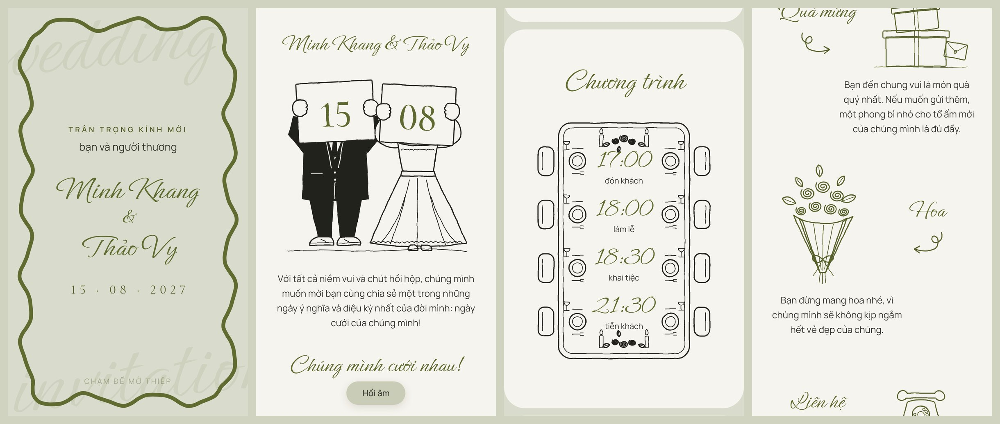

# Thiệp cưới online

Repo có **2 mẫu thiệp**, dùng chung file Google Sheets. Mẫu đỏ rượu dùng ảnh trong `assets/anh/` (đang là ảnh mẫu); mẫu xanh pastel dùng ảnh cưới thật trong `xanh-pastel/assets/anh/`:

| Mẫu | Link | Sửa nội dung ở |
|---|---|---|
| **Đỏ rượu** — phong bì sáp, polaroid, tim rơi (thiệp mẫu Minh Khang & Thảo Vy) | `/mau-do-ruou.html` | `js/config.js` |
| **Xanh pastel** — thiệp Văn Hùng & Tuyết Anh: giấy xanh xô thơm dập nổi lá cây, hai cánh mở, dấu sáp vàng | `/xanh-pastel/` | `xanh-pastel/js/config.js` |

Thiệp Văn Hùng & Tuyết Anh đang chạy ở **https://vhung-spec.github.io/bokin-thiep-onl/** — trang gốc mở thẳng mẫu xanh pastel (giữ nguyên `?to=…` của link mời riêng), ví dụ `https://vhung-spec.github.io/bokin-thiep-onl/?to=Ngọc%20Anh`. Tên miền riêng `thiepmoihungtuyetanh.xyz` sẽ gắn sau (xem mục “Tên miền riêng”).

---

## Mẫu đỏ rượu — phong bì sáp, polaroid

Thiệp cưới một trang cho điện thoại: phong bì “Nhấp để mở” với con dấu sáp, ảnh polaroid bay ra, tim rơi, lịch tháng cưới, đếm ngược, lễ cưới của **nhà trai / nhà gái** kèm **ngày âm lịch**, lịch trình, album ảnh, xác nhận tham dự, **sổ lưu bút có ký tên bằng tay**, mã QR mừng cưới và lời cảm ơn.

Chỉ là HTML + CSS + JavaScript thuần: **không cần cài đặt, không cần build**, đăng miễn phí lên GitHub Pages / Vercel / Netlify.



## Các phần của thiệp

1. **Phong bì** — “Nhấp để mở”, ảnh polaroid trượt vào phong bì, nắp mở ra, 2 ảnh bay lên, tim bắt đầu rơi, nhạc nền phát.
2. **Lịch tháng** — trên nền ảnh, ngày cưới đánh dấu bằng trái tim.
3. **Chữ lồng + đếm ngược** — ngày / giờ / phút / giây.
4. **Ảnh chính**, **lời mời** (“Quý vị & Gia đình” hoặc tên khách), ảnh **chú rể / cô dâu**, tên **bố mẹ hai bên**.
5. **Tab Nhà gái / Nhà trai** — mỗi nhà một danh sách lễ (Lễ Vu Quy, Lễ Thành Hôn, Tiệc Cưới…) với giờ, thứ, ngày dương, **ngày âm lịch tự tính**, địa điểm, nút *Xem bản đồ*.
6. **Lịch trình** trong ngày và **dress code**.
7. **Album hình cưới** — chạm để xem ảnh lớn, vuốt qua lại.
8. **Xác nhận tham dự** — tên, khách nhà trai/nhà gái, có đến không, số người.
9. **Sổ lưu bút** — khách **ký tên bằng ngón tay** và gửi lời chúc; lời chúc hiện ngay trên thiệp.
10. **Gửi quà mừng cưới** — mã QR của hai nhà, nút sao chép số tài khoản.
11. **Đếm ngược trong trái tim** và **lời cảm ơn**.

## Sửa thông tin

Mọi nội dung nằm trong **`js/config.js`**: tên, ngày giờ từng lễ, địa chỉ, link bản đồ, bố mẹ hai bên, lịch trình, bảng màu dress code, tài khoản mừng cưới…
Thứ trong tuần và ngày âm lịch được tính tự động (thuật toán âm lịch Việt Nam của Hồ Ngọc Đức, múi giờ +7).

Nhớ sửa thêm `<title>` và các thẻ `og:` trong `index.html` — đó là chữ hiện ra khi gửi link qua Zalo/Messenger.

### Thay ảnh

Thư mục `assets/anh/` đang chứa **ảnh mẫu** (khung có ghi “ẢNH MẪU · thay file …”). Chép ảnh cưới của bạn đè lên **đúng tên file**:

| File | Dùng cho | Tỉ lệ nên dùng |
|---|---|---|
| `bia.jpg`, `bia-2.jpg` | ảnh trên phong bì và 2 ảnh bay ra | dọc 4:5 |
| `lich.jpg` | nền phía sau lịch tháng | ngang |
| `chinh.jpg` | ảnh lớn sau phần đếm ngược | dọc 3:4 |
| `chu-re.jpg`, `co-dau.jpg` | ảnh chú rể, cô dâu | dọc 4:5 |
| `album-01.jpg` … `album-08.jpg` | album (thêm/bớt trong `config.js`) | dọc 3:4 |
| `luu-but.jpg` | ảnh trong phần sổ lưu bút | dọc 3:4 |
| `cam-on.jpg` | ảnh lớn cuối thiệp | dọc 3:4 |

Mẹo: nén ảnh còn khoảng 200–400 KB mỗi tấm (rộng ~1200px) để thiệp mở nhanh trên 4G.

### Mời riêng từng khách

Thêm `?to=Tên` vào cuối link; thêm `&nha=trai` (hoặc `&nha=gai`) để mở sẵn đúng tab lễ của nhà mời:

```
https://vhung-spec.github.io/bokin-thiep-onl/mau-do-ruou.html?to=Anh%20Thắng%20và%20người%20thương&nha=trai
```

Phần lời mời sẽ hiện tên khách thay cho “Quý vị & Gia đình”, ô tên trong form được điền sẵn, và cột “Link mời” trong Google Sheets cho biết ai đã trả lời.

### Mã QR mừng cưới

Trong `config.js` → `gift.accounts`, với mỗi nhà:
- điền `number` (số tài khoản) và `bankId` (mã ngân hàng, ví dụ `VCB`, `MB`, `TCB`, `ACB`, `BIDV`, `ICB`) → thiệp tự tạo mã **VietQR** (qua dịch vụ img.vietqr.io); **hoặc**
- tải ảnh QR từ app ngân hàng, đặt vào `assets/` và ghi đường dẫn vào `qr`.

Chưa điền gì thì ô QR hiện “Mã QR đang được cập nhật”. **Hãy quét thử mã QR bằng app ngân hàng trước khi gửi thiệp.**

### Nhạc nền

Đặt file mp3 vào `assets/nhac-nen.mp3` (hoặc đổi `music` trong `config.js`). Nhạc phát khi khách mở phong bì; nút tròn góc dưới bên trái để bật/tắt. Không có file thì nút tự ẩn. Nên dùng nhạc có giấy phép miễn phí.

## Mẫu xanh pastel — thiệp Văn Hùng & Tuyết Anh


Thư mục `xanh-pastel/`. Một trang cuộn dọc cho điện thoại, theo bản thiết kế PDF 12 trang (bỏ các khoảng trống lớn giữa các trang):

1. **Bìa** — giấy xanh xô thơm dập nổi lá cây gấp hai cánh, cánh phải đè lên cánh trái với bóng rất nhẹ; dấu sáp vàng có cành lá nổi ở đường gáp, dòng “Chạm để mở thiệp” (kèm tên khách nếu link có `?to=`). Chạm dấu sáp hoặc dòng chữ: dấu sáp nhấc nhẹ, hai cánh mở sang hai bên trong ~0,8 giây, rồi “Văn Hùng”, trái tim, “Tuyết Anh”, “28 . 11 . 2026” hiện dần. Cuộn được ngay sau khi mở. Điện thoại bật *giảm chuyển động* thì vào thẳng nội dung.
2. **Lời mời** — hai cột nhà trai / nhà gái, “Trân trọng kính mời *Quý khách*” (hoặc tên khách), số 28 lớn, *Thứ Bảy · 10:30*, ngày âm lịch tự tính, tên địa điểm được tô nổi, địa chỉ và nút **Xem đường đi** (mở Google Maps).
3. **Ảnh cầu thang + Countdown** — đếm ngày/giờ/phút/giây tới đúng 10:30 giờ Việt Nam (khách ở múi giờ khác vẫn đúng); tới giờ thì hiện “Đã đến giờ chung vui cùng chúng mình”.
4. **Save The Date** — lịch tháng 11/2026 trên giấy ngà, Chủ nhật đầu tuần, ngày 28 trong trái tim vàng; dải lá vàng khép phần lịch.
5. **Love Story** — chữ Lora dễ đọc trên khung giấy sáng (kèm chữ ký) đặt trên giấy xô thơm.
6. **Timeline** — 10:00 đón khách, 10:30 khai tiệc, trục mảnh nối các chấm.
7. **The Album** — ảnh lớn lướt ngang (ảnh kế tiếp ló ra), có nút ‹ › trên máy tính, chạm để xem ảnh lớn.
8. **Xác Nhận Tham Dự** — tên, “Mình sẽ tham dự” / “Rất tiếc, mình không thể tham dự”; ô số người chỉ hiện khi chọn tham dự. **Chỉ báo gửi thành công khi Google Sheets thật sự lưu xong** (xem mục bên dưới).
9. **Gửi Quà Mừng** — phong bì xanh xô thơm đóng dấu sáp vàng; chạm để mở hộp có đúng ảnh mã QR, VPBank 3646866, nút sao chép số tài khoản và nút Đóng.
10. **Thank you!** — ảnh bên vịnh, lời cảm ơn, chữ ký, ngày cưới, dải lá vàng kết thúc.

Màu: giấy xô thơm #A6A882, nền nội dung kem #EFF0E8, mặt giấy #FFFDF8, chữ xanh rêu #2D3826, nút xanh ô liu #55633F, vàng đồng #B48A55. Giấy dập nổi, dấu sáp và cành lá vàng được vẽ bằng code (xem [`tools/hoa-tiet/`](tools/hoa-tiet/)). Chữ viết tay (Ephesis) chỉ dùng cho tên, chữ ký và tiêu đề ngắn; chữ đọc dùng Lora 17–18px.

Sửa nội dung trong **`xanh-pastel/js/config.js`** (tên, giờ, địa điểm, bố mẹ, love story, lịch trình, album, tài khoản mừng cưới…). Ảnh cưới nằm trong `xanh-pastel/assets/anh/` (`anh-01.jpg` …). Trong `config.js`:
- `photos.hero` / `photos.heroFocus`: ảnh lớn đầu tiên và điểm giữ trong khung khi cắt (mặc định `50% 88%` để giữ cả gương mặt và váy);
- `photos.ending`: ảnh mở đầu phần cảm ơn;
- `album.photos`: danh sách `{ src, alt }` (thêm `focus: '50% 30%'` nếu muốn chỉnh chỗ cắt một ảnh).

**Ảnh bìa của chủ thiệp** nằm trong `xanh-pastel/assets/bia/`, khai báo ở `config.js` → `cover`:
- `paper: 'assets/bia/bia.jpg'` — bìa hai cánh đã xoá dấu sáp, đường gáp nằm đúng giữa ảnh. Hai cánh bìa ghép thành đúng một ảnh phủ kín màn hình.
- `seal: 'assets/bia/dau-sap.webp'` — dấu sáp tách riêng, nền trong suốt; `sealAt` là vị trí của nó trên ảnh bìa (tâm x, y và bề rộng theo tỉ lệ), để dấu sáp nằm đúng chỗ rồi nhấc lên khi mở.
- `page: 'assets/bia/trang-dau.jpg'` — trang trong có khung và hoa (ảnh của chủ thiệp): nền phần đầu thiệp ngay sau khi mở bìa và trang “Thank you!” cuối thiệp; chữ nằm trong lòng khung.
- `cream: 'assets/bia/giay-kem.jpg'` và `creamColor` — giấy kem lấy từ lòng khung của trang trong, nền các phần ở giữa (lời mời, đếm ngược, lịch, câu chuyện, album, xác nhận, quà mừng).
Dấu sáp và bìa được tách từ ảnh bìa bằng `tools/hoa-tiet/tach_bia.py`; giấy kem làm bằng `tools/hoa-tiet/giay_be.py`. Để trống các dòng này thì thiệp quay về giấy và dấu sáp tự vẽ. Lưu ý: repo công khai nên ai cũng tải được file trong `assets/`.

### Bản nhà trai (giờ, địa điểm riêng)

- Bản chính (khách nhà gái và khách không ghi bên): **10:30 Thứ Bảy 28.11.2026**, Nhà văn hoá Tổ 1 Ngọc Trục — `date` và `venue` trong `xanh-pastel/js/config.js`.
- Bản nhà trai: **10:30 Chủ Nhật 29.11.2026**, Tổ hợp Thể thao Vũ Tuấn Mobile (Lôi Xá, Tuệ Tĩnh, Hải Phòng) — mục `sides.trai` trong `config.js`. Chỉ ghi những gì khác bản chính; ngày âm lịch, thứ, đếm ngược, lịch tháng tự tính lại.
- Link chung cho nhà trai: `https://vhung-spec.github.io/bokin-thiep-onl/nha-trai/`. Trang `nha-trai/index.html` mở thiệp với `?ben=trai` và có ảnh / lời xem trước riêng ghi 29.11 (`xanh-pastel/assets/og-image-nha-trai.jpg`) cho Zalo, Messenger.
- Ở trang tạo link, khách ghi **Khách nhà trai** tự nhận link `…/nha-trai/?to=Tên&ben=trai`; lời nhắn dùng `{thoigian}` và `{diadiem}` nên tự ghi đúng giờ, nơi theo bên của khách.
- Đổi ngày / địa điểm nhà trai: sửa `sides.trai` trong `config.js`, sửa lời xem trước trong `nha-trai/index.html` (và ảnh xem trước nếu đổi ngày).

### Tạo link mời riêng cho từng khách (`xanh-pastel/tao-link.html`)

Mở **https://vhung-spec.github.io/bokin-thiep-onl/xanh-pastel/tao-link.html** trên điện thoại hoặc máy tính. Link mời tạo ra lấy theo địa chỉ trang web đang mở (gắn tên miền riêng rồi thì mở trang này qua tên miền để link mời dùng tên miền):

1. **Nhạc nền** — dán link YouTube (`youtube.com/watch?v=…`, `youtu.be/…`, có thể chọn giây bắt đầu) hoặc đường dẫn file nhạc (`assets/nhac/ten-file.mp3` sau khi chép file vào `xanh-pastel/assets/nhac/`). Bấm **Nghe thử** để kiểm tra; video YouTube nào chặn phát trên trang khác thì chọn video khác.
2. **Lời nhắn gửi kèm** — sửa tuỳ ý; `{ten}` là tên khách, `{link}` là link thiệp riêng.
3. **Khách mời** — thêm từng người hoặc nhiều người một lúc, ghi khách nhà trai / nhà gái. Mỗi khách có nút **Gửi lời mời** (mở bảng chia sẻ của điện thoại: Zalo, Messenger, tin nhắn…), **Chép lời mời**, **Chép link**, xem thử thiệp, gửi SMS, sửa (kể cả nhạc riêng cho từng khách), đánh dấu đã gửi.

Link riêng có dạng `…/xanh-pastel/?to=Tên khách&ben=trai&nhac=yt:mã-video@30`: bìa và lời mời hiện đúng tên khách, phần xác nhận tham dự điền sẵn tên và ghi khách của bên nào vào Google Sheets, nhạc phát khi khách chạm mở thiệp (nút góc trên để tắt/bật). Danh sách khách lưu trong trình duyệt của máy đang dùng. Muốn không lo mất và dùng chung trên nhiều máy (cô dâu và chú rể cùng thêm khách): ở mục **3. Khách mời**, nhập mật khẩu xem thống kê (`MAT_KHAU`) vào ô **Lưu danh sách lên Google Sheet** → **Kết nối**.

- Lần đầu kết nối, danh sách đang có trên máy được đưa lên trang tính **Khách mời** (cùng bảng tính với phản hồi). Sau đó mỗi lần thêm / sửa / xoá / đánh dấu đã gửi, trang tự lưu sau khoảng 1 giây; mở lại trang (hoặc bấm **Đồng bộ ngay**) thì tải danh sách mới nhất về.
- Các máy đã kết nối dùng chung danh sách **và** nhạc nền chung (bài + giây bắt đầu). Lời nhắn gửi kèm vẫn riêng từng máy.
- Có thể sửa thẳng trên trang tính: tên, bên, cột **Đã gửi** (gõ `Có` hoặc `x`); thêm khách bằng cách gõ tên vào dòng trống cuối bảng. Đừng sửa cột **Mã** (đang ẩn) và đừng chèn cột vào giữa; muốn ghi chú thì thêm cột bên phải.
- Mất mạng thì danh sách vẫn giữ trên máy và tự lưu lại khi có mạng.
- Vẫn nên thỉnh thoảng bấm **Tải danh sách (CSV)** để lưu dự phòng. Chưa kết nối thì dùng **Nhập từ file CSV** để chuyển danh sách sang máy khác.
- Trang báo “Apps Script đang chạy bản cũ”: bấm **Chép mã Code.gs mới**, dán đè vào Apps Script, gõ lại mật khẩu vào dòng `MAT_KHAU`, Lưu, rồi **Triển khai → Quản lý các bản triển khai → Chỉnh sửa → Phiên bản mới → Triển khai** (link `/exec` giữ nguyên).

Nhạc mặc định cho mọi link có thể đặt luôn trong `config.js` → `music` (link YouTube hoặc file mp3). Nên dùng nhạc bạn có quyền sử dụng.

### Lịch trình ngày đón dâu 29/11 (`lich-trinh/`)

Trang riêng cho **gia đình, đội xe, người đi đón dâu, người ở nhà chuẩn bị tiệc** — không phải cho mọi khách mời, nên **không** đặt trên thiệp; nút *Xem lịch trình đón dâu · 29/11* nằm ở đầu trang tạo link.

- Link gửi Zalo: **https://vhung-spec.github.io/bokin-thiep-onl/lich-trinh/** (mở thẳng lịch, không phong bì, không nhạc). Trên trang có nút *Chia sẻ lịch trình*.
- Link giữ nguyên qua mọi lần sửa: ai mở lại tin nhắn cũ cũng thấy bản mới nhất. Dòng *Cập nhật lần cuối* tự lấy từ lần sửa tệp gần nhất.

**Sửa lịch: chỉ sửa `lich-trinh/lich-trinh.json`** (trên điện thoại: mở tệp trên GitHub → bút chì ✏️ → sửa → *Commit changes*; khoảng 1–2 phút sau trang đổi). Các mốc xếp theo 3 chặng (`chang`), thứ tự trên trang là thứ tự trong tệp. Trong mỗi mốc:

| Muốn sửa | Trường |
|---|---|
| Giờ | `batDau` (ví dụ `"11:15"`), `ketThuc` khi là một khoảng (`"08:45"`). Nghi lễ / khai tiệc đang để `""` → trang hiện *Sau khi đoàn về / Sau nghi lễ* và *Giờ cụ thể: chờ gia đình cập nhật*; điền `batDau` là tự hiện giờ |
| Giờ có mặt (khác giờ xe chạy 05:00) | `gioCoMat`, ví dụ `"04:40"` |
| Địa chỉ | `diaDiem.ten`, `diaDiem.diaChi`, `diaDiem.banDo` (link Google Maps) — nút **Chỉ đường** chỉ hiện khi đổi `diaDiem.daXacNhan` thành `true` |
| Đầu mối | `dauMoi.ten`, `dauMoi.soDienThoai` (số đủ 10 chữ số) → hiện nút **Gọi …** |
| Thứ tự nghi thức ở nhà gái | `nghiThuc` của mốc 07:00, ví dụ `["Thắp hương", "Trao lễ"]` (nằm trong *Xem chi tiết*) |
| Số xe, hướng dẫn tập trung… | `chiTiet`, ví dụ `["Xe 1: 15A-123.45 — anh Tuấn"]` (nằm trong *Xem chi tiết*) |
| Lời nhắc | `canChuanBi`; người liên quan: `nguoiCanXem` |

**Lộ trình xe cho lái xe** — cung đường cố định, hai lượt cùng một hành lang: Phố Văn → Quốc lộ 5 (Mỹ Hào, Như Quỳnh, Gia Lâm) → cầu Thanh Trì → Vành đai 3 trên cao → lối Nguyễn Trãi/Nguyễn Xiển → Nguyễn Trãi – Trần Phú → Quang Trung → Chu Văn An – Vạn Phúc → Đại Mỗ → Ngọc Trục. Lượt về theo cùng hành lang, đi thẳng tới Tổ hợp Thể thao Vũ Tuấn Mobile. Tránh CT04, Tố Hữu, không xuống Vành đai 3 sớm. Link gửi riêng lái xe: `.../lich-trinh/#lo-trinh`.

- **Đầu trang: hai ô xếp dọc** “05:00 · Nhà trai → Nhà gái” (nút *Mở Google Maps đi nhà gái*) và “08:30–08:45 · Nhà gái → Tổ hợp Vũ Tuấn” (nút *Mở Google Maps về Vũ Tuấn*; lượt về đi thẳng tới Tổ hợp Thể thao Vũ Tuấn Mobile, ghim `diaDiemChung.tiecNhaTrai`). Mỗi nút: điểm đi/đến cố định, `travelmode=driving`, `dir_action=navigate`, 6 điểm khoá đúng thứ tự. Android mở thẳng ứng dụng Google Maps (dự phòng: đúng link HTTPS); iPhone dùng link HTTPS. Mục gập “Nếu bản đồ mở trong Zalo” có hướng dẫn và nút sao chép link. Chữ trên ô và nút: `loTrinh.luot[].oTieuDe`, `nutGoogle`.
- **Lịch cả buổi sáng**: mỗi mốc một dòng (giờ + `tomTat`), chạm mới mở địa điểm, người tham gia, việc cần chuẩn bị. Mốc chưa có giờ hiện chữ `gioNgan` (“Sau đó”).
- **Từng lượt** là một mục gập riêng: bản đồ cố định, các điểm đi qua, chỉ đường từng bước, GPX. Bản đồ chỉ vẽ khi mở mục (đúng kích thước, thấy trọn tuyến).
- **Bản đồ cố định + GPX** (`lo-trinh-co-dinh.geojson`, `lo-trinh-di.gpx`, `lo-trinh-ve.gpx`) vẽ sẵn, không tính lại khi khách mở trang. Nút *Vị trí của tôi* báo “Vị trí đang gần tuyến của đoàn” hoặc “Cách tuyến vẽ khoảng X m”; gần Vành đai 3 có nhắc GPS dễ lẫn đường trên cao/dưới thấp.

| Muốn sửa | Ở đâu (tệp `lich-trinh/lich-trinh.json`) |
|---|---|
| **Ghim nhà trai / nhà gái** (dùng chung cho lịch, điểm đầu lượt đi, điểm cuối lượt về) | `diaDiemChung.nhaTrai.toaDo`, `diaDiemChung.nhaGai.toaDo` — viết `"vĩ độ,kinh độ"`. Ghi chú ghim: `ghiChuGhim` (đang là “Ghim khu Phố Văn…”). **Sau khi đổi toạ độ**: chạy `python3 tools/lo-trinh/tao_lo_trinh.py` (vẽ lại đường + GPX), mở trang xem đoạn nối từ ghim ra QL5. Chưa chạy lại thì trang tự hiện lời nhắc dưới bản đồ. |
| **Liên hệ đoàn xe** | `loTrinh.lienHeDoanXe`: `nguoiPhuTrach` (ưu tiên người ngồi cạnh tài xế), `vaiTro`, `soDienThoai`, `bienSoXeDanDoan`, `nhomZalo` (`https://zalo.me/g/…`), `diemHenKhiTachDoan`. Ô trống thì trang ẩn. |
| Nhãn nút, 6 điểm khoá | `loTrinh.luot[].nutGoogle`, `loTrinh.luot[].quaDiem` — chỉ đổi khi đã biết điện thoại dẫn sai ở nhánh nào |
| Các chỗ rẽ bằng chữ, quy tắc đi đoàn | `loTrinh.luot[].cacBuoc`, `loTrinh.quyTac` |
| Đổi cung đường vẽ | điểm đi qua trong `tools/lo-trinh/tao_lo_trinh.py`, rồi chạy lại script |

- Giữ nguyên dấu `"…"` và dấu phẩy. Nếu lỡ sửa sai định dạng, trang báo lỗi và tạm hiện bản người xem đã mở lần trước — mở trang ngay sau khi sửa để kiểm tra.
- Nơi đón dâu sáng 29/11 (đã xác nhận): **Trung tâm ngoại ngữ STEN**, Khu giãn dân/14 P. Ngọc Trục, Đại Mỗ — khác nhà văn hoá Tổ 1 Ngọc Trục (nơi tiệc 28/11). Trang điểm tại nhà trai.
- Đổi ngày / giờ chính thì sửa thêm lời xem trước (`og:`) trong `lich-trinh/index.html`; ảnh xem trước là `lich-trinh/og-lich-trinh.jpg`.

### Link ngắn có tên khách (Facebook, Zalo hiện “Thân gửi …”)

Facebook / Zalo chỉ đọc lời xem trước của đúng trang được gửi, nên link `?to=Tên` dài và không hiện tên khách. Bật **Dùng link ngắn** ở mục **3. Khách mời** của trang tạo link:

- Mỗi khách có một trang nhỏ `m/<mã 6 ký tự>.html` trong repo (mã tính từ mã khách, máy nào cũng ra cùng mã). Link gửi khách dạng `https://vhung-spec.github.io/bokin-thiep-onl/m/ab12cd`; xem trước trên Facebook / Zalo có tiêu đề **“Thân gửi Tên khách 💌”**, ảnh và lời mời đúng bản (nhà trai: 29.11, còn lại: 28.11). Mở ra là chuyển ngay tới thiệp của khách.
- Cần mã GitHub (fine-grained token, **Contents: Read and write** cho repo này) — cùng mã dùng để tải nhạc. Trang tự ghi các trang nhỏ lên GitHub (gộp nhiều khách vào một commit) sau khi thêm / sửa khách hoặc đổi nhạc; GitHub Pages cập nhật mất khoảng 1–2 phút, trong lúc đó thẻ khách ghi “Đang tạo link ngắn…”.
- Máy không có mã GitHub vẫn dùng được các link ngắn đã tạo. Xoá khách không xoá trang nhỏ, nên link đã gửi vẫn mở được.
- Lưu ý: repo công khai nên ai xem repo cũng thấy tên khách trong thư mục `m/` (các trang có `noindex` để không lên Google).

### Thống kê khách tham dự (`xanh-pastel/thong-ke.html`)

Xem ngay trên trang: ai sẽ tham dự (kèm số người), ai báo vắng, ai chưa phản hồi; chia theo khách nhà trai / nhà gái; tìm tên; **Tải file thống kê (CSV)** để mở bằng Excel. Không cần mở Google Sheets — Google Apps Script chỉ làm chỗ lưu phản hồi phía sau (trang tĩnh không tự lưu được).

- Cần kết nối chỗ lưu một lần (mục “Lưu dữ liệu vào Google Sheets” bên dưới) và **đặt mật khẩu**: gõ vào dòng `var MAT_KHAU = ''` trong trình soạn Apps Script (đừng đưa mật khẩu lên GitHub), hoặc **Cài đặt dự án → Thuộc tính tập lệnh**, tên `MAT_KHAU`. Không có mật khẩu thì không ai xem được danh sách.
- “Chưa phản hồi” lấy từ trang tính **Khách mời** nếu trang Tạo link đã kết nối Google Sheet (xem được trên mọi máy); chưa kết nối thì lấy danh sách khách trên máy bạn dùng để gửi.
- Trong Google Sheets có sẵn trang tính **“Thống kê”** (tự tạo khi có phản hồi đầu tiên): số phản hồi, tổng số người tham dự, chia theo nhà trai / nhà gái, số người vắng. Khách gửi lại xác nhận (cùng tên, cùng link) thì dòng cũ được cập nhật, không bị đếm trùng.
- Chưa nối Google Sheets thì trang có nút **Xem thử với dữ liệu mẫu**.

Ảnh mới nên thu nhỏ còn cạnh dài khoảng 1600px. 

Phiên bản cũ của mẫu xanh pastel (có thanh lời chúc chạy, thả tim) vẫn còn trong lịch sử git, commit `14691db`.

## Lưu dữ liệu vào Google Sheets

Chưa cài thì mẫu đỏ rượu chạy ở **chế độ xem thử** (xác nhận tham dự không gửi đi đâu, lời chúc chỉ lưu trên máy bạn). Mẫu xanh pastel thì **không bao giờ báo thành công giả**: chưa có `endpoint` nó báo khách là phản hồi *chưa được gửi*; có `endpoint` thì chỉ báo “đã lưu” khi Apps Script trả về `{"ok": true}`.

1. Tạo một Google Sheet mới.
2. Vào **Tiện ích mở rộng → Apps Script**, xoá code mẫu, dán nội dung file [`google-apps-script/Code.gs`](google-apps-script/Code.gs), bấm Lưu.
3. Bấm **Triển khai → Tùy chọn triển khai mới**, chọn loại **Ứng dụng web**:
   - *Thực thi với tư cách*: **Tôi**
   - *Người có quyền truy cập*: **Bất kỳ ai**
4. Bấm **Triển khai**, cấp quyền, sao chép **URL ứng dụng web** (dạng `https://script.google.com/macros/s/.../exec`).
5. Dán URL vào `endpoint` trong `js/config.js` (mẫu đỏ rượu) và/hoặc **`xanh-pastel/js/config.js` → dòng `endpoint: ''`** (mẫu xanh pastel), ví dụ `endpoint: 'https://script.google.com/macros/s/AKfy.../exec',`.
6. Mở thiệp, gửi thử một phản hồi và kiểm tra dòng mới trong trang tính **“Xác nhận tham dự”**.

Kết quả: trang tính **“Xác nhận tham dự”** và **“Lời chúc”** tự được tạo. Lời chúc mới hiện trên thiệp cho mọi khách. Muốn ẩn một lời chúc, gõ `x` vào cột **Ẩn** của dòng đó.
Sửa code Apps Script sau này thì phải **Triển khai → Quản lý triển khai → Chỉnh sửa → Phiên bản mới** thì thay đổi mới có hiệu lực.
Để xem trang thống kê, đặt mật khẩu ở dòng `var MAT_KHAU = ''` trong Apps Script (hoặc **Cài đặt dự án → Thuộc tính tập lệnh**, tên `MAT_KHAU`). Mật khẩu gõ trong mã được Apps Script nhớ vào Thuộc tính tập lệnh ở lần chạy đầu, nên các lần dán bản Code.gs mới sau đó không cần gõ lại.

## Xem thử trên máy

```bash
python3 -m http.server 8000
```

rồi mở <http://localhost:8000/xanh-pastel/> (mẫu xanh pastel; <http://localhost:8000> cũng tự chuyển vào đây) hoặc <http://localhost:8000/mau-do-ruou.html> (mẫu đỏ rượu). Mở thẳng file `index.html` cũng xem được, trừ phần tải lời chúc từ Google Sheets.

## Đăng lên mạng miễn phí (GitHub Pages)

1. Đẩy code lên GitHub.
2. Vào **Settings → Pages**, *Build and deployment* chọn **Deploy from a branch**, chọn nhánh và thư mục `/ (root)`, bấm **Save**.
3. Sau khoảng 1 phút, thiệp có ở `https://<tên-tài-khoản>.github.io/<tên-repo>/`.

### Tên miền riêng (sẽ gắn sau: thiepmoihungtuyetanh.xyz, DNS ở Mắt Bão)

Hiện thiệp chạy ở `https://vhung-spec.github.io/bokin-thiep-onl/` (chưa khai báo tên miền). Khi muốn gắn tên miền:
- DNS (đã làm): bản ghi **A** `@` → `185.199.108.153` (thêm được `185.199.109.153`, `185.199.110.153`, `185.199.111.153` thì càng tốt) và **CNAME** `www` → `vhung-spec.github.io.`
- GitHub: **Settings → Pages → Custom domain** = `thiepmoihungtuyetanh.xyz` → **Save** (GitHub tự tạo file `CNAME` ở gốc repo). Khi báo *DNS check successful* thì tích **Enforce HTTPS**.
- Sửa `og:url` / `og:image` trong `index.html` và `xanh-pastel/index.html` sang tên miền để Zalo/Facebook hiện ảnh xem trước. Link mời ở trang tạo link tự đổi theo tên miền khi mở trang đó qua tên miền.
- Trang gốc `index.html` chỉ chuyển thẳng vào `xanh-pastel/` và mang sẵn ảnh xem trước; mẫu đỏ rượu cũ ở `mau-do-ruou.html`.

## Cấu trúc thư mục

```
index.html                 trang gốc của tên miền: chuyển thẳng vào thiệp xanh pastel
mau-do-ruou.html           mẫu đỏ rượu (khung trang)
css/style.css              màu sắc, bố cục, hiệu ứng (mẫu đỏ rượu)
js/config.js               ← nội dung mẫu đỏ rượu
js/lunar.js                đổi ngày dương sang âm lịch
js/art.js                  hình vẽ SVG: hoa rum, phong bì, dấu sáp, chữ lồng
js/main.js                 mở phong bì, lịch, đếm ngược, form, sổ lưu bút, QR
google-apps-script/Code.gs lưu xác nhận, lời chúc, lượt thả tim vào Google Sheets (dùng chung)
tools/hoa-tiet/            code tách ảnh bìa (dấu sáp, nền, trang trong, giấy kem) và vẽ hoạ tiết vàng của mẫu xanh pastel
assets/anh/                ảnh mẫu của mẫu đỏ rượu
assets/og-image.jpg        ảnh xem trước khi chia sẻ link

xanh-pastel/               mẫu xanh pastel
  index.html               khung trang
  css/style.css            màu sắc, bố cục, hiệu ứng
  js/config.js             ← nội dung mẫu xanh (sửa ở đây)
  js/art.js                hình vẽ SVG: hoa trắng, dấu sáp, giấy xé, phong bì, chữ T uốn lượn
  js/main.js               mở bìa, đếm ngược giờ VN, lịch, album, xác nhận tham dự, hộp QR
  js/nhac.js               nhạc nền: link YouTube hoặc file mp3 (dùng chung cho thiệp và trang tạo link)
  tao-link.html, js/tao-link.js, css/tao-link.css  trang tạo link mời riêng cho từng khách
  thong-ke.html, js/thong-ke.js  trang thống kê khách tham dự (cần mật khẩu MAT_KHAU)
m/                                trang nhỏ của link ngắn (trang tạo link tự ghi lên GitHub)
nha-trai/index.html               cửa vào bản nhà trai (ảnh, lời xem trước 29.11)
lich-trinh/                       lịch trình ngày đón dâu 29/11 — sửa lich-trinh.json; lộ trình xe cố định lo-trinh-co-dinh.geojson
tools/lo-trinh/tao_lo_trinh.py    tạo lại cung đường cố định + file GPX
  assets/bia/              ảnh bìa, dấu sáp, trang trong, giấy kem (từ ảnh của chủ thiệp)
  assets/nhac/             (tuỳ chọn) file nhạc nền mp3
  assets/anh/              ảnh cưới của mẫu xanh pastel
  assets/giay-xo-tham.webp, giay-kem.webp  giấy dập nổi lá cây (ô lặp liền mạch)
  assets/dau-sap-vang.webp, canh-la-vang.webp, day-la-vang.webp  dấu sáp, cành lá, dải lá vàng
  assets/qr-mung-cuoi.png  mã VietQR VPBank 3646866
  assets/og-image.jpg      ảnh xem trước khi chia sẻ link
```

## Ghi chú

- Bìa, trang trong và giấy kem của mẫu xanh pastel làm từ **ảnh bìa do chủ thiệp cung cấp** (`xanh-pastel/assets/bia/`). Cành lá vàng, dải lá vàng và bản giấy/dấu sáp dự phòng được **tự vẽ bằng code** trong `tools/hoa-tiet/`. Bản nền màu nước + hoa dâm bụt trước đó còn trong lịch sử git, commit `4d4db84`.
- Bố cục và tính năng của hai mẫu lấy cảm hứng từ các mẫu thiệp online thương mại. **Toàn bộ code và hình vẽ (hoa rum, mẫu đơn, phong bì, con dấu sáp, nền giấy thủ công, giấy xé, chữ lồng) đều tự vẽ bằng SVG** cho dự án này; không dùng ảnh, logo hay hình của mẫu gốc.
- Font Google Fonts (giấy phép SIL OFL, hỗ trợ tiếng Việt): Corinthia, Oswald, Noto Serif, Cormorant Garamond (mẫu đỏ rượu); Ephesis, Lora, Playfair Display, Be Vietnam Pro (mẫu xanh pastel).
- Hỗ trợ chế độ *giảm chuyển động* của điện thoại: tắt hiệu ứng và tim rơi.
- Thiết kế cũ (tông xanh xô thơm, nét vẽ tay) vẫn còn trong lịch sử git, commit `63f5f7b`.
